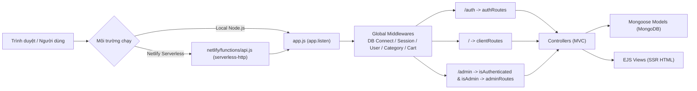
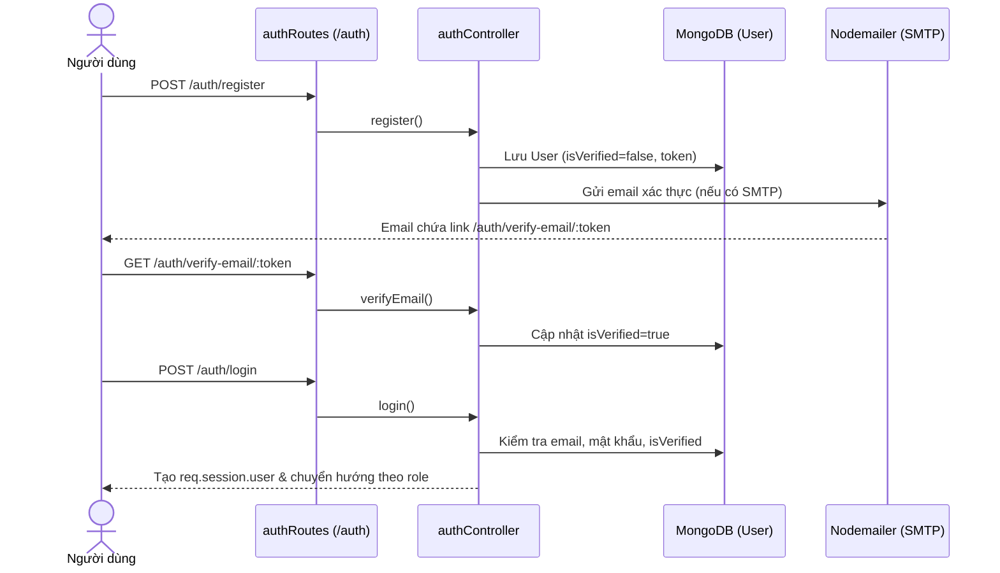

# Website Bán Máy Tính (Computer Store)

> **Tác giả:** Nguyễn Văn Tùng – MSV: 521100184  
> **Đơn vị:** Trường Đại học Phương Đông – PDU (Khoa Công nghệ Thông tin & Truyền thông)


<div align="center">


</div>

---

## Mục lục

- [Giới thiệu](#giới-thiệu)
- [Tính năng chính](#tính-năng-chính)
- [Kiến trúc và Công nghệ](#kiến-trúc-và-công-nghệ)
- [Hướng dẫn luồng nghiệp vụ chính](#hướng-dẫn-luồng-nghiệp-vụ-chính)
- [Cấu trúc thư mục](#cấu-trúc-thư-mục)
- [Hướng dẫn cài đặt](#hướng-dẫn-cài-đặt)
- [Cấu hình biến môi trường](#cấu-hình-biến-môi-trường)
- [Khôi phục dữ liệu mẫu](#khôi-phục-dữ-liệu-mẫu)
- [Tài khoản mẫu](#tài-khoản-mẫu)
- [Giao diện website](#giao-diện-website)
- [Đóng góp và Giấy phép](#đóng-góp-và-giấy-phép)

---

## Giới thiệu

**Website Bán Máy Tính (`website-computer-store`)** là ứng dụng web thương mại điện tử xây dựng theo mô hình **MVC** trên nền tảng **Node.js**, **Express.js**, **EJS** và **MongoDB**. Hệ thống hỗ trợ đồng thời hai luồng nghiệp vụ: mua sắm trực tuyến cho khách hàng và quản trị vận hành cửa hàng cho quản trị viên.

Ứng dụng chạy trực tiếp trên môi trường máy chủ truyền thống (`node app.js`) hoặc triển khai dưới dạng hàm không máy chủ (**Netlify Functions**) thông qua `serverless-http`.

---

## Tính năng chính

### Phía khách hàng (Client)
- **Duyệt và tìm kiếm sản phẩm:** Xem trang chủ, danh mục sản phẩm, lọc theo nhiều tiêu chí, tìm kiếm theo từ khóa và gợi ý tìm kiếm.
- **Chi tiết sản phẩm và đánh giá:** Xem thông số kỹ thuật, hình ảnh sản phẩm, gửi mới hoặc chỉnh sửa đánh giá.
- **Giỏ hàng và mã giảm giá:** Thêm, cập nhật số lượng, xóa sản phẩm trong giỏ hàng và áp dụng mã khuyến mãi (`Coupon`).
- **Đặt hàng và thanh toán đa phương thức:** Hỗ trợ thanh toán khi nhận hàng (**COD**), chuyển khoản ngân hàng qua mã **VietQR** và cổng thanh toán trực tuyến **VNPay** (kèm thử lại thanh toán khi chưa hoàn tất).
- **Quản lý tài khoản:** Đăng ký, xác thực email, đăng nhập, quên/đặt lại mật khẩu, cập nhật hồ sơ, xem lịch sử đơn hàng và lịch sử đánh giá.

### Phía quản trị (Admin)
- **Bảng điều khiển thống kê (Dashboard):** Theo dõi doanh thu, số lượng đơn hàng, sản phẩm bán chạy và doanh thu theo danh mục theo khoảng thời gian.
- **Quản lý danh mục và sản phẩm:** Thêm, sửa, xóa danh mục và sản phẩm kèm tải lên hình ảnh thông qua `multer`.
- **Quản lý đơn hàng:** Theo dõi chi tiết đơn hàng và cập nhật trạng thái xử lý (`pending`, `confirmed`, `shipping`, `delivered`, `cancelled`).
- **Quản lý người dùng, mã giảm giá và đánh giá:** Phân quyền tài khoản (`user` / `admin`), tạo/chỉnh sửa mã giảm giá và kiểm duyệt đánh giá sản phẩm.

---

## Kiến trúc và Công nghệ

| Thành phần | Công nghệ sử dụng | Vai trò trong hệ thống |
| :--- | :--- | :--- |
| **Runtime & Framework** | Node.js, Express.js (`^4.18.2`) | Xử lý định tuyến (routing), middleware và logic máy chủ |
| **View Engine & UI** | EJS (`^3.1.9`), Bootstrap, HTML/CSS/JS | Kết xuất giao diện phía máy chủ (SSR) tương thích đa thiết bị |
| **Cơ sở dữ liệu** | MongoDB, Mongoose (`^7.8.13`) | Lưu trữ dữ liệu hướng tài liệu và ánh xạ schema |
| **Xác thực & Bảo mật** | `express-session`, `bcryptjs` | Quản lý phiên đăng nhập và băm mật khẩu người dùng |
| **Tải tệp & Email** | `multer`, `nodemailer` | Tải ảnh sản phẩm/danh mục và gửi email xác thực/đặt lại mật khẩu |
| **Thanh toán** | `vnpay` (`^2.2.0`), VietQR | Tích hợp thanh toán trực tuyến VNPay và tạo mã QR chuyển khoản |
| **Triển khai Serverless** | `serverless-http`, Netlify Functions | Đóng gói ứng dụng Express thành hàm Serverless trên Netlify |

### Kiến trúc MVC và Vòng đời Request

Mọi yêu cầu từ trình duyệt đi qua tầng cấu hình trung tâm trong `app.js` trước khi tới các router chuyên biệt:

1. **Kết nối & Phiên làm việc:** Đảm bảo kết nối MongoDB (`config/db.js`), phân tích body (`express.json()`, `express.urlencoded()`), và khởi tạo `express-session`.
2. **Global Middlewares:** Tự động nạp thông tin người dùng hiện tại (`getCurrentUser`), danh sách danh mục (`categoryMiddleware`) và số lượng sản phẩm trong giỏ (`cartMiddleware`) vào `res.locals` cho toàn bộ view EJS.
3. **Định tuyến theo phân hệ:** Phân luồng sang `clientRoutes` (`/`), `authRoutes` (`/auth`) hoặc `adminRoutes` (`/admin`).
4. **Kiến trúc triển khai kép:** Khi chạy local (`require.main === module`), `app.js` mở cổng HTTP trực tiếp; khi triển khai lên Netlify, `netlify/functions/api.js` bọc `app` qua `serverless-http` và điều hướng mọi request theo `netlify.toml`.



---

## Hướng dẫn luồng nghiệp vụ chính

### 1. Luồng Đăng ký & Xác thực Email
- Người dùng truy cập `GET /auth/register`, nhập thông tin và gửi biểu mẫu tới `POST /auth/register`.
- `authController.register` kiểm tra trùng email, băm mật khẩu bằng `bcryptjs`, sinh `emailVerificationToken` ngẫu nhiên bằng `crypto` và lưu người dùng với trạng thái `isVerified: false`.
- Nếu cấu hình `SMTP_USER` và `SMTP_PASS` hợp lệ, hệ thống gửi liên kết xác thực qua `Nodemailer` (`utils/mailer.js`). Người dùng nhấn vào liên kết `GET /auth/verify-email/:token` để kích hoạt tài khoản (`isVerified: true`). Nếu chưa cấu hình SMTP, hệ thống tự động kích hoạt để thuận tiện kiểm thử.

### 2. Luồng Đăng nhập & Phân quyền
- Người dùng gửi email và mật khẩu qua `POST /auth/login`. Hệ thống đối chiếu mật khẩu đã băm bằng `user.matchPassword()`, kiểm tra trạng thái xác thực và trạng thái khóa tài khoản.
- Khi hợp lệ, `authController.login` lưu thông tin người dùng vào `req.session.user` và điều hướng theo vai trò: `admin` chuyển tới `/admin/dashboard`, `user` chuyển tới `/`.
- Các route yêu cầu đăng nhập được bảo vệ bởi middleware `isAuthenticated`, và khu vực quản trị yêu cầu thêm `isAdmin` (`middlewares/auth.js`).



### 3. Luồng Quên & Đặt lại mật khẩu
- Người dùng nhập email tại `GET /auth/forgot-password` → `POST /auth/forgot-password`.
- Hệ thống tạo `resetPasswordToken` có thời hạn **30 phút** và gửi email chứa đường dẫn `/auth/reset-password/:token`.
- Người dùng mở liên kết, nhập mật khẩu mới qua `POST /auth/reset-password/:token` để cập nhật mật khẩu và xóa token.

### 4. Luồng Mua sắm, Giỏ hàng & Thanh toán
- Khách hàng duyệt sản phẩm (`GET /`, `/products`, `/category/:slug`, `/search`), xem chi tiết (`/product/:slug`) và thêm sản phẩm vào giỏ (`POST /cart/add`).
- Tại trang giỏ hàng (`/cart`), khách hàng có thể cập nhật số lượng (`POST /cart/update`), xóa sản phẩm (`POST /cart/remove`) hoặc áp dụng mã giảm giá (`POST /cart/apply-coupon`).
- Khi đặt hàng tại `/checkout` (`POST /checkout/place-order`), hệ thống hỗ trợ 3 phương thức thanh toán:
  - **COD:** Tạo đơn hàng với `paymentStatus: 'pending'` và chuyển tới trang xác nhận `/order-success/:orderCode`.
  - **Chuyển khoản (Banking / VietQR):** Tạo đơn hàng và hiển thị mã QR VietQR động trên trang xác nhận đơn hàng.
  - **VNPay:** Tạo giao dịch qua `POST /vnpay-payment` (`utils/vnpay.js`), chuyển hướng sang cổng thanh toán VNPay và xử lý kết quả trả về tại `GET /vnpay-return` (hỗ trợ thử lại qua `GET /orders/:orderCode/retry-vnpay-payment`).

### 5. Luồng Quản trị (Admin)
- Quản trị viên đăng nhập bằng tài khoản có `role: 'admin'` để truy cập `/admin/dashboard`.
- Tại đây, quản trị viên quản lý toàn diện: **Danh mục** (`/admin/categories`), **Sản phẩm** (`/admin/products` với upload ảnh Multer), **Đơn hàng** (`/admin/orders` cập nhật trạng thái `pending → confirmed → shipping → delivered / cancelled`), **Người dùng** (`/admin/users`), **Mã giảm giá** (`/admin/coupons`) và **Kiểm duyệt đánh giá** (`/admin/reviews`).

---

## Cấu trúc thư mục

```text
Project-ComputerStore/
├── app.js                  # Điểm khởi chạy Express app và cấu hình middleware toàn cục
├── package.json            # Khai báo dependencies và scripts khởi chạy
├── .env.example            # Tệp mẫu các biến môi trường cần thiết
├── netlify.toml            # Cấu hình build và chuyển hướng cho Netlify Functions
├── config/
│   └── db.js               # Kết nối MongoDB và tái sử dụng connection trên serverless
├── controllers/
│   ├── adminController.js  # Xử lý nghiệp vụ trang quản trị
│   ├── authController.js   # Xử lý đăng ký, đăng nhập, xác thực email, đặt lại mật khẩu
│   └── clientController.js # Xử lý trang chủ, sản phẩm, giỏ hàng, đặt hàng, tài khoản
├── middlewares/
│   └── auth.js             # Kiểm tra đăng nhập (isAuthenticated) và quyền quản trị (isAdmin)
├── models/
│   ├── Cart.js             # Schema giỏ hàng
│   ├── Category.js         # Schema danh mục sản phẩm
│   ├── Coupon.js           # Schema mã giảm giá
│   ├── Order.js            # Schema đơn hàng
│   ├── Product.js          # Schema sản phẩm
│   ├── Review.js           # Schema đánh giá sản phẩm
│   └── User.js             # Schema người dùng
├── routes/
│   ├── adminRoutes.js      # Định tuyến khu vực quản trị (/admin)
│   ├── authRoutes.js       # Định tuyến xác thực (/auth)
│   └── clientRoutes.js     # Định tuyến phía khách hàng (/)
├── utils/
│   ├── mailer.js           # Cấu hình Nodemailer gửi email
│   └── vnpay.js            # Cấu hình và tiện ích tích hợp cổng thanh toán VNPay
├── views/                  # Các template EJS cho client, admin, auth và partials
├── public/                 # Tài nguyên tĩnh (CSS, JS, ảnh giao diện, ảnh upload)
├── netlify/
│   └── functions/
│       └── api.js          # Wrapper serverless-http cho Netlify Functions
└── backup-database/        # Dữ liệu JSON mẫu để import vào MongoDB
```

---

## Hướng dẫn cài đặt

### Yêu cầu hệ thống
- **Node.js** (>= 14.x) và **npm** (>= 6.x)
- **MongoDB** (cài đặt local hoặc sử dụng MongoDB Atlas)

### Các bước thực hiện

1. **Clone mã nguồn về máy:**
   ```bash
   git clone https://github.com/Tung-Pro/Project-ComputerStore
   cd Project-ComputerStore
   ```

2. **Cài đặt các gói phụ thuộc:**
   ```bash
   npm install
   ```

3. **Tạo tệp `.env` từ tệp mẫu `.env.example`:**
   ```bash
   cp .env.example .env
   ```
   *(Trên Windows PowerShell, dùng lệnh `Copy-Item .env.example .env`)*

4. **Khởi chạy ứng dụng:**
   ```bash
   # Chạy ở chế độ thông thường
   npm start

   # Hoặc chạy ở chế độ phát triển với nodemon
   npm run dev
   ```
   Mặc định ứng dụng lắng nghe tại `http://localhost:3000`.

---

## Cấu hình biến môi trường

Cập nhật các giá trị trong tệp `.env` theo môi trường của bạn:

```env
# Database config
PORT=3000
MONGO_URI=mongodb://localhost:27017/computer-store

# Session config
SESSION_SECRET=your_session_secret

# Mail config
SMTP_USER=your_email@gmail.com
SMTP_PASS=your_email_password

# VNPay config
TMN_CODE=your_vnpay_TmnCode
SECURE_SECRET=your_vnpay_HashSecret
```

> **Lưu ý:** Không commit tệp `.env` chứa thông tin nhạy cảm lên kho lưu trữ Git.

---

## Khôi phục dữ liệu mẫu

Thư mục `backup-database/` chứa sẵn 7 tệp JSON tương ứng với 7 collection trong MongoDB:

- `computer-store.users.json` — Danh sách người dùng
- `computer-store.categories.json` — Danh mục sản phẩm
- `computer-store.products.json` — Danh sách sản phẩm
- `computer-store.carts.json` — Dữ liệu giỏ hàng
- `computer-store.orders.json` — Danh sách đơn hàng
- `computer-store.coupons.json` — Danh sách mã giảm giá
- `computer-store.reviews.json` — Danh sách đánh giá

Bạn có thể sử dụng công cụ `mongoimport` (thuộc MongoDB Database Tools) để khôi phục dữ liệu mẫu vào cơ sở dữ liệu `computer-store`:

```bash
mongoimport --db computer-store --collection users --file backup-database/computer-store.users.json --jsonArray
mongoimport --db computer-store --collection categories --file backup-database/computer-store.categories.json --jsonArray
mongoimport --db computer-store --collection products --file backup-database/computer-store.products.json --jsonArray
mongoimport --db computer-store --collection carts --file backup-database/computer-store.carts.json --jsonArray
mongoimport --db computer-store --collection orders --file backup-database/computer-store.orders.json --jsonArray
mongoimport --db computer-store --collection coupons --file backup-database/computer-store.coupons.json --jsonArray
mongoimport --db computer-store --collection reviews --file backup-database/computer-store.reviews.json --jsonArray
```

---

## Tài khoản mẫu

Sau khi khôi phục dữ liệu từ `backup-database/`, bạn có thể đăng nhập bằng các tài khoản mẫu sau:

| Vai trò | Email | Mật khẩu |
| :--- | :--- | :--- |
| **Quản trị viên (Admin)** | `admin@gmail.com` | `admin@123` |
| **Khách hàng (User)** | `test@gmail.com` | `test@123` |

---

## Giao diện website

### Giao diện xác thực

| Trang đăng ký | Trang đăng nhập |
| :---: | :---: |
|  |  |

### Giao diện khách hàng

| Trang chủ | Trang danh sách sản phẩm |
| :---: | :---: |
|  |  |
| **Trang danh mục sản phẩm** | **Trang tìm kiếm & lọc sản phẩm** |
|  |  |
| **Trang chi tiết & đánh giá sản phẩm** | **Trang giỏ hàng** |
|  |  |
| **Trang thanh toán** | **Trang xác nhận đơn hàng** |
|  |  |
| **Trang quản lý tài khoản** | **Trang lịch sử đơn hàng** |
|  |  |
| **Trang lịch sử đánh giá** | |
|  | |

### Giao diện quản trị

| Trang tổng quan | Trang quản lý người dùng |
| :---: | :---: |
|  |  |
| **Trang quản lý danh mục** | **Trang quản lý sản phẩm** |
|  |  |
| **Trang quản lý mã khuyến mãi** | **Trang quản lý đánh giá** |
|  |  |
| **Trang quản lý đơn hàng** | |
|  | |

---

## Đóng góp và Giấy phép

Mọi đóng góp nhằm cải thiện dự án đều được hoan nghênh. Vui lòng fork repository và tạo pull request sau khi hoàn thiện thay đổi.

Dự án được phát hành theo giấy phép [MIT License](./LICENSE).

Copyright © Designed & Developed by [Nguyễn Văn Tùng](https://www.facebook.com/vtungpro) – MSV: 521100184 – Trường Đại học Phương Đông (PDU).
